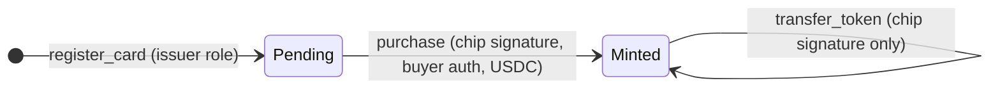

# RecordPool Smart Card: architecture

## Preamble

```
Title: RecordPool Smart Card: architecture and design rationale
Author: David Geddes
Status: Living document (describes the code in this repository)
Created: 2026-11-18
Contract: contracts/recordpool-smart-card (soroban-sdk 28, OpenZeppelin Stellar Contracts 0.8)
Related: docs/sep-draft-physical-backed-tokens.md (the interface as a draft standard)
```

This document explains why the contract is built the way it is: its data structures, its threat model and the protocol trade-offs behind each decision. It's a design doc for this one contract. The [draft SEP](docs/sep-draft-physical-backed-tokens.md) specifies the public interface; this document covers the implementation behind it.

## Simple Summary

Each RecordPool card carries a HaLo NFC chip with a secp256k1 key that can't be extracted. The contract pairs one token with each chip and lets the token move only when that chip signs. Whoever holds the card controls the token. The primary sale is paid in USDC in the same transaction as the mint, and anyone who taps a sold card can play its track without a wallet.

## Goals

| Goal | How the design meets it |
|---|---|
| Ownership follows the physical object | Every mint and transfer needs a fresh chip signature; wallet transfers are disabled. |
| No trusted backend | Signatures are verified on-chain with the `secp256k1_recover` host function. No server holds keys or approves transfers. |
| Stellar conventions throughout | SHA-256, SEP-53 message digests, XDR addresses and the network ID; ERC-5791 is the model for behaviour, not for encodings. |
| One-signature checkout | The buyer's wallet signs one authorization tree covering `purchase` and the nested USDC transfer. |
| Reuse audited code | Token ownership, enumeration and roles come from OpenZeppelin Stellar Contracts; only the PBT logic is custom. |
| Playable by anyone | `music_url` is a read-only view, called as a free simulation from a static page. |

Non-goals: resale royalties, protecting the audio file itself, and recovering a token whose card is lost. Each is discussed under [Trade-offs and limitations](#trade-offs-and-limitations).

## Architecture

The [README](README.md#architecture) has the component and sequence diagrams.

The contract has four parts, one file each:

| File | Role |
|---|---|
| `contract.rs` | Public functions, chip-signature checking, and the OpenZeppelin trait implementations |
| `storage.rs` | Storage keys, typed getters and setters, and TTL extension |
| `events.rs` | `ChipSet`, `CardRegistered`, `CardPurchased` |
| `errors.rs` | `CardError`, codes 3000–3011 |

OpenZeppelin provides the rest: `NonFungibleToken` with `type ContractType = Enumerable`, `NonFungibleEnumerable`, and `AccessControl` with the `#[only_role]` macro.

## Card lifecycle as a state machine

A chip is in one of three states. Each transition is a single atomic transaction.



- **Unknown (no entries) → Pending**: `register_card` (issuer role). Rejected if the chip is already Pending or Minted, so a chip can never be registered twice, even after it's sold.
- **Pending → Minted**: `purchase`. The chip signs a mint to the buyer, the buyer's wallet authorises the payment, the token is minted and the chip is paired with it. If any step fails, nothing changes.
- **Minted → Minted**: `transfer_token`. The owner changes; the pairing never does.

There's no transition out of Minted: no burn, no unpairing and no chip replacement.

## Data structures

### Storage layout

| Key | Value | Tier | Why this tier |
|---|---|---|---|
| `Config` | `payment_token`, `treasury`, `max_duration_window` | instance | Read on every purchase and transfer; small, contract-wide, lives as long as the contract |
| `Pending(chip_id)` | price (`i128`) | persistent | Inventory must survive until sold; removed at mint |
| `ChipToken(chip_id)` | token id (`u32`) | persistent | The pairing is permanent |
| `TokenChip(token_id)` | chip id | persistent | Reverse of the above |
| `ChipNonce(chip_id)` | 32-byte nonce | persistent | See below: losing it must never reset it |
| `Music(chip_id)` | track URL | persistent | Read on every tap |

OpenZeppelin keeps owners, balances, enumeration indexes and metadata in its own keys.

### Decisions

- **`chip_id` is SHA-256 of the uncompressed public key, as `BytesN<32>`.** It's fixed-size, so storage keys are cheap and uniform; it's what `secp256k1_recover` → `sha256` produces directly, so verification is a single comparison; and it uses Stellar's hash rather than Ethereum's 20-byte keccak address. The contract never stores public keys.
- **Two maps for the pairing, `ChipToken` and `TokenChip`.** A tap starts from a chip (`token_id_for_chip`, `music_url`); an authenticity check starts from a token (`is_chip_signature_for_token`). Both lookups are a single read. The cost is one extra persistent entry per card, written once.
- **`Pending` is separate from `ChipToken`.** A card for sale has no token yet, so the two states are different keys rather than one entry with an optional field. That makes "is this chip known?" two existence checks, and lets `purchase` distinguish "not registered" (3000) from "already sold" (3002).
- **Music URL keyed by chip, not token.** The URL exists before there's a token (it's set at registration), and a tap starts from the chip.
- **Price as `i128`.** That's the SEP-41 amount type, so it passes to the token's `transfer` unchanged. Prices must be positive (3003).
- **Token ids as `u32`, minted sequentially.** OpenZeppelin's default; `token_uri` is `base_uri + token_id`.
- **The nonce is persistent, not temporary.** A temporary entry is deleted when its TTL runs out. The nonce would silently reset to zero, and the chip's first signatures would match again. The time window happens to block that today, since expiry takes far longer than 600 s, but replay protection shouldn't depend on two settings lining up. A persistent entry is archived instead, and must be restored, with its value, before it can be read.
- **Persistent entries are extended by 30 days whenever they're touched.** Live cards stay live; a dormant card's entries are archived, not lost, and can be restored.
- **The contract instance is extended by 30 days on every state change.** `Config`, OpenZeppelin's metadata and the reference to the contract code live in instance storage, which has one TTL for all of it. OpenZeppelin leaves extending it to the contract, so the constructor, `register_card`, `purchase`, `transfer_token` and `set_treasury` each call `storage::extend_instance_ttl`. Views don't: a simulation can't extend anything.
- **Error codes start at 3000.** OpenZeppelin uses the 200 range for NFT errors and 2000 for access control, so a failed transaction's code says which layer rejected it.

## Protocol

### What the chip signs

```
message = SHA-256(
    contract                      XDR ScVal address
  ‖ network_id                    SHA-256 of the network passphrase
  ‖ chip_id
  ‖ chip_nonce
  ‖ to                            XDR ScVal address
  ‖ signature_timestamp           u64, big-endian
  ‖ SHA-256(extras)
)

digest = SHA-256("Stellar Signed Message:\n" ‖ message)        SEP-53
```

The chip signs `digest` with HaLo key slot 1 and returns `r ‖ s` and `v`; the client passes `recovery_id = v − 27`.

Each field closes off one attack:

| Field | Without it |
|---|---|
| `contract` | A signature for one deployment would work on another that holds the same chip. |
| `network_id` | A testnet signature would work on mainnet. |
| `chip_id` | Ambiguity between chips (ERC-5791's reference digest leaves it out). |
| `chip_nonce` | A signature could be used more than once. |
| `to` | Anyone who sees a signature could redirect the token to themselves. |
| `signature_timestamp` | A signature captured once could be held and used much later. |
| `SHA-256(extras)` | No way for an application to bind its own data; hashing keeps the message fixed-size. |

### Verification

`consume_chip_signature`, used by both `purchase` and `transfer_token`:

1. Reject a timestamp later than the ledger's (3008) or older than `max_duration_window` (3009).
2. Rebuild `message` and `digest` on-chain from current state.
3. Reject a `recovery_id` other than 0 or 1 (3007).
4. `sha256(secp256k1_recover(digest, signature, recovery_id))` must equal `chip_id` (3006).
5. Replace the nonce with `SHA-256(digest ‖ prng)`.

### Why these choices

- **SEP-53 rather than EIP-191.** SEP-53 is Stellar's standard for signing messages. Chips can't sign Ed25519, so this keeps its prefix and hash and changes only the curve. The prefix also keeps a PBT signature from being mistaken for a signature in another scheme.
- **`secp256k1_recover` rather than verifying against a stored key.** Recovery returns the key, so the contract stores a 32-byte hash per chip instead of a 65-byte key, and one comparison does the check.
- **A `signature_message` view.** Clients never reimplement XDR encoding; they ask the contract for the exact bytes. Because the view reads the live nonce, a client can't sign for a stale one by mistake.
- **The nonce mixes in the Soroban PRNG.** ERC-5791 mixes in the previous block hash, which a Soroban contract can't read. The PRNG makes the next nonce unpredictable before the transaction executes, so a chip can't be made to sign a future transfer in advance.
- **A nonce and a time window, not one or the other.** The nonce stops reuse after a signature is accepted. The window stops a signature that was captured but never submitted. 600 s on testnet leaves room for a phone round trip without leaving a captured signature useful for long.
- **`transfer_token` needs no wallet authorization.** The chip signature is the authorization, and it names `to`, so anyone can submit it (usually the recipient) and a front-runner can only complete the transfer as signed.
- **`purchase` needs both the chip and the buyer's wallet.** The chip proves the card is present; the wallet authorises the payment. Both are bound to the same `buyer`.
- **The USDC transfer is nested in `purchase`.** Soroban's authorization tree lets the buyer sign once for the call and the token transfer inside it. There's no `approve` step and no allowance left behind.

## Threat model

### Assets

What an attacker might want to steal, forge or break:

| Asset | What an attacker would want | What protects it |
|---|---|---|
| The token (ownership of the card) | Move it to themselves without holding the card | Every transfer needs a fresh chip signature; wallet transfers are disabled. |
| The purchase price | Redirect the USDC, or take it without the card being minted | Payment and mint are one atomic transaction; the buyer authorizes only that transfer. |
| The issuer role | Register a software key as a "card" and sell fakes | `register_card` is gated by `#[only_role(operator, "issuer")]`. |
| Each chip's nonce | Reset or predict it, so an old tap can be replayed | It changes after every use, mixes in the PRNG, and is persistent, so it can't expire back to zero. |

### Actors and what they can do

| Actor | Can | Cannot |
|---|---|---|
| Card holder | Move the token to anyone by tapping | Move a token without its card |
| Token owner without the card | Nothing to the token | Transfer it: wallet transfers fail (3010) |
| Issuer (role) | Register new chips, set the treasury | Move, burn or re-pair any minted token |
| Admin | Grant and revoke roles (two-step admin transfer) | Move any token |
| Observer of pending transactions or the ledger | See signatures and chip ids | Redirect a signature (`to` is bound) or replay it (nonce) |
| Anyone | Call views, play a sold card's track | Change state without a chip signature or a role |

Holding the issuer key doesn't give power over cards already sold. Compromising it lets an attacker register fake chips for sale or redirect future proceeds, but not take existing tokens.

### Threats

| Threat | Mitigation | Residual risk |
|---|---|---|
| Counterfeit card | A copy has the public key but not the private key, so it can't produce a signature that recovers to `chip_id` (3006). | A copy can still *play* the track: playing needs only the public key. |
| Replayed tap | The nonce changes after each accepted signature; the time window bounds unsubmitted ones. | None within the model. |
| Cross-deployment or cross-network replay | `contract` and `network_id` are in the message. | None. |
| Front-running a transfer | `to` is in the message. | The submitter can delay, but not redirect. |
| Malicious app asks the chip to sign | The SEP-53 prefix and the message binding limit what a signature can be used for. | Key slot 1 signs any digest. A malicious page that gets a tap can have the chip sign a transfer to the attacker. Users should only tap cards into apps they trust. |
| Fake chip registered | `register_card` is gated by the issuer role. | Trust starts with the issuer. A production version would verify HaLo's manufacturer attestation (`attestSig`) at registration. |
| Lost or stolen card | None: possession is ownership, by design. | The token goes with the card, or stays stuck with a lost one. |
| Storage expiry | Card entries are extended on access and the instance on every state change; persistent entries are archived, not deleted; the nonce can't reset. | A contract left unused for 30 days is archived and needs restoring before its next call. |
| Payment failure mid-purchase | The whole transaction is atomic. | None: tested in `underfunded_purchase_is_atomic`. |

## Trade-offs and limitations

- **No resale royalties.** A tap transfer carries no price, so there's nothing to take a royalty from. ERC-5791 leaves royalties out too. An escrow, where the buyer prepays and the chip-signed transfer releases the funds minus a royalty, would add one.
- **Buying needs the card in hand.** `purchase` needs a chip signature, as ERC-5791 recommends for minting. That suits a merch table, a shop, or a card shipped before it's claimed.
- **No chip replacement or recovery.** A damaged or lost card can't be re-paired. Adding that would give someone a way to move a token without the card, which is what the design rules out.
- **The music URL is public.** Contract storage is readable by anyone. Protecting the audio would need a server that checks a fresh chip signature with `is_chip_signature_for_token` before streaming.
- **`is_chip_signature_for_token` is stateless.** It proves the chip signed `data`, not when. Callers should put a fresh random value in `data`.
- **Unrecoverable signatures trap.** If `secp256k1_recover` can't recover a key at all, the host fails the call, so `is_chip_signature_for_token` traps instead of returning `false`.
- **Not upgradeable.** There's no upgrade function, so the code a buyer audits is the code that runs. Changes mean a new deployment, which on testnet is what this repository does.
- **Not signature-compatible with Ethereum PBTs.** The same HaLo chip works with both, but its id and message format follow Stellar conventions here.
- **Not audited, and not tested on a physical chip.** The simulated chip follows libhalo's documented `sign` command and output.

## Alternatives considered

| Alternative | Why not |
|---|---|
| Implement ERC-5791's encodings exactly (keccak, EIP-191, 20-byte addresses) | Would carry Ethereum conventions into a Stellar contract for no benefit: the two chains can't share token state. |
| Keep wallet transfers enabled alongside chip transfers | On-chain ownership could drift from the physical card, which is the problem a PBT exists to solve. |
| Store each chip's public key and verify signatures against it | Stores 65 bytes per chip instead of 32; recovery does the same job with less state. |
| Symmetric-key NFC chips verified by a backend | Needs a server that holds chip keys and can be trusted, which is the trust the on-chain design removes. |
| A temporary-storage nonce | Expiry would reset it to zero; see [Decisions](#decisions). |
| Hand-written NFT logic | OpenZeppelin's is audited, and `Enumerable` comes as a contract type rather than code to maintain. |

## Test coverage

`cargo test` runs the contract tests in an in-process Soroban environment with a real USDC Stellar Asset Contract. The chip is simulated with k256, which signs the exact SEP-53 digest. The main properties and the tests that check them:

| Property | Test |
|---|---|
| Purchase pays the treasury, mints and pairs | `purchase_with_tap_pays_treasury_and_mints` |
| Counterfeit chip rejected | `purchase_requires_the_chip` |
| Signature bound to the buyer / recipient | `purchase_signature_names_the_buyer`, `transfer_signature_names_the_recipient` |
| Single use | `chip_signature_is_single_use` |
| Time window edges | `signature_timestamp_window` |
| Bound to this contract | `signature_is_bound_to_this_contract` |
| `extras` covered by the signature | `extras_are_signed` |
| Wallet transfers disabled | `wallet_transfers_are_disabled` |
| Atomic purchase | `underfunded_purchase_is_atomic` |
| Recovery id validated | `recovery_id_must_be_0_or_1` |
| Role gating | `only_issuer_can_register` |
| Music URL only after sale | `sold_card_plays_for_anyone` |
| Instance TTL extended by state changes | `state_changes_extend_instance_ttl` |

`scripts/demo.sh` runs the same lifecycle on testnet; the README lists one run's transactions.

## Implementation

- Contract: [`contracts/recordpool-smart-card/src`](contracts/recordpool-smart-card/src), about 40 KB of WebAssembly.
- Chip tooling and simulator: [`tools/halo-tool`](tools/halo-tool/src/main.rs).
- Tap page: [`web/index.html`](web/index.html).
- Testnet deployment: [`deployments/testnet.json`](deployments/testnet.json).
