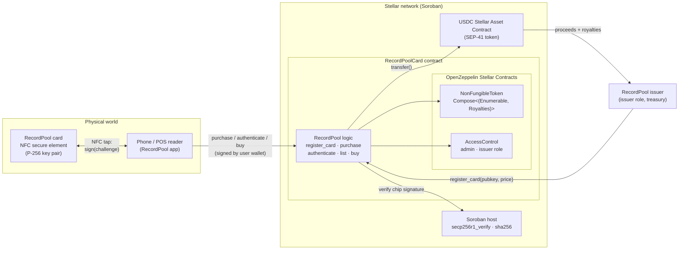
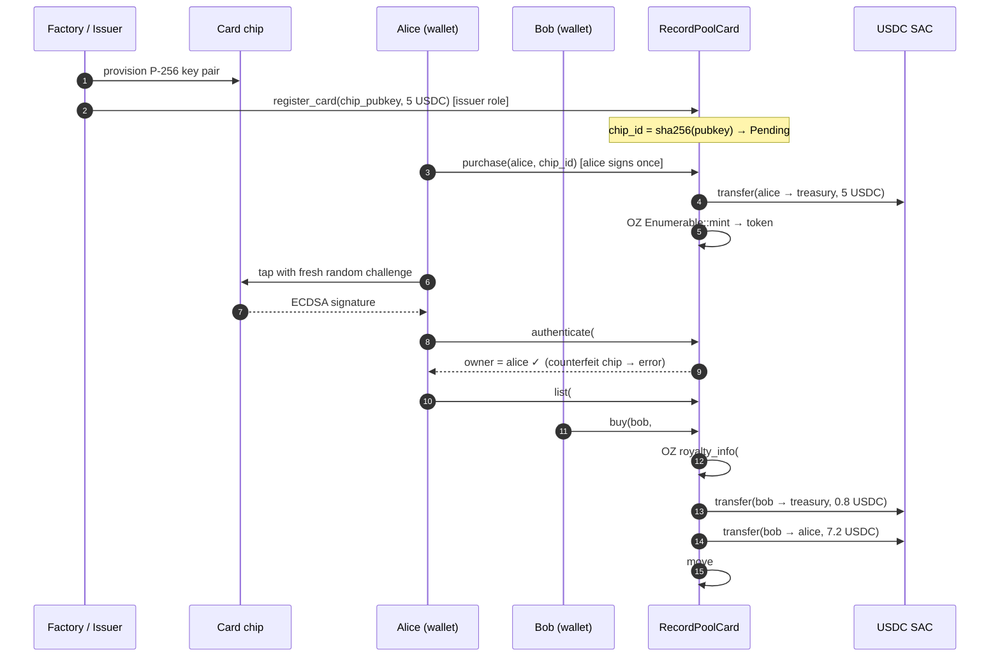

# RecordPool Chipped Card — an RWA-backed NFT on Stellar Soroban

A **RecordPool card** is an NFC chip card for music: tap it on a phone and it plays.
Each card's chip also holds its own P-256 key pair.
This Soroban contract gives each card exactly one on-chain token, sells it for **USDC**,
lets anyone holding the card **prove on-chain that it's genuine**, and **enforces a royalty** when it's resold.

It's built on [OpenZeppelin Stellar Contracts](https://github.com/OpenZeppelin/stellar-contracts) v0.8.0.
The token standard, enumeration, royalty bookkeeping and role-based access control come from that audited library.
This repo only adds the RecordPool-specific logic: binding chips to tokens, USDC checkout, chip authentication and resale settlement.

| | |
|---|---|
| **Network** | Stellar testnet |
| **Contract** | [`CDFRZTK7YZOHQO6WCNM3XWFOJWFQSNZ32EZVOVRMYSGHFVALDVD2ZZYN`](https://stellar.expert/explorer/testnet/contract/CDFRZTK7YZOHQO6WCNM3XWFOJWFQSNZ32EZVOVRMYSGHFVALDVD2ZZYN) |
| **Payment token** | Circle testnet USDC — SAC [`CBIELTK6…DAMA`](https://stellar.expert/explorer/testnet/contract/CBIELTK6YBZJU5UP2WWQEUCYKLPU6AUNZ2BQ4WWFEIE3USCIHMXQDAMA) (`USDC:GBBD47IF…LFLA5`) |
| **Stack** | Rust · soroban-sdk 28 · OpenZeppelin `stellar-tokens` / `stellar-access` / `stellar-macros` 0.8 · Stellar CLI 30 |

---

## Why this use case

Stellar is built for payments, stablecoins and real-world assets. A tap-to-play music card touches all three:

- **RWA**: the token stands for a specific physical card. The chip's public key is stored on-chain, so the token and the card are cryptographically linked. The NFC tap that plays the music can also have the chip sign a challenge, which proves the card is genuine.
- **Stablecoin payments**: both the primary sale and resales settle in USDC through its Stellar Asset Contract (SAC). It's the same USDC that classic Stellar accounts, anchors and wallets already hold.
- **Programmable commerce**: the royalty is paid out inside the resale transaction. It isn't left to a marketplace to honour. A royalty can be set per card, so resales of an artist's card can pay that artist.

## Architecture



### Card lifecycle



## Contract interface

| Function | Who | What it does |
|---|---|---|
| `__constructor(admin, payment_token, treasury, royalty_bps, base_uri, name, symbol)` | deployer | Runs atomically with deployment. Sets OZ metadata, the default royalty, the admin and the `issuer` role. |
| `register_card(chip_pubkey, price, operator)` | `issuer` | Adds a manufactured card to inventory and returns its `chip_id`. |
| `purchase(buyer, chip_id) → token_id` | buyer | Pays `price` in USDC to the treasury and mints the token, in one atomic transaction. |
| `authenticate(token_id, challenge, signature) → owner` | anyone | Verifies the chip's P-256 signature on-chain. Run it as a free simulation. |
| `list(seller, token_id, price)` / `cancel_listing` | owner | Creates or cancels a resale listing. |
| `buy(buyer, token_id)` | buyer | Pays the royalty and the seller from one signature, then moves the token. |
| `card_price`, `token_for_chip`, `chip_pubkey`, `get_listing`, `config` | anyone | Read-only lookups. |
| `set_treasury` | `issuer` | Changes where primary-sale proceeds go. |
| **From OpenZeppelin:** `balance`, `owner_of`, `transfer`, `transfer_from`, `approve`, `approve_for_all`, `name`, `symbol`, `token_uri`, `total_supply`, `get_token_id`, `get_owner_token_id`, `royalty_info`, `set_default_royalty`, `set_token_royalty`, `grant_role`, `revoke_role`, `has_role`, `transfer_admin_role`, … | | |

### What comes from OpenZeppelin vs. what's custom

```rust
// The token standard is assembled from OZ extensions, not hand-written:
#[contractimpl(contracttrait)]
impl NonFungibleToken for RecordPoolCard {
    type ContractType = Compose<(Enumerable, Royalties)>;
    // transfer/transfer_from wrapped only to invalidate stale resale listings
}
#[contractimpl(contracttrait)] impl NonFungibleEnumerable for RecordPoolCard {}
#[contractimpl(contracttrait)] impl NonFungibleRoyalties  for RecordPoolCard { /* #[only_role(operator, "issuer")] */ }
#[contractimpl(contracttrait)] impl AccessControl         for RecordPoolCard {}
```

All the custom code is in [`contracts/recordpool-card/src/contract.rs`](contracts/recordpool-card/src/contract.rs). It's about 200 lines of business logic, and none of it re-implements anything the library already provides.

## Ethereum vs. Soroban

The ERC-721 patterns, and how this project does the same thing on Stellar. A longer, partner-facing version with code side by side is in [docs/ethereum-vs-soroban.md](docs/ethereum-vs-soroban.md).

| Concern | Ethereum (ERC-721 + OZ Solidity) | Soroban (this repo) |
|---|---|---|
| Building the token | Multiple inheritance: `is ERC721, ERC721Enumerable, ERC2981, AccessControl`, plus `_update` / `supportsInterface` overrides to resolve the diamond | Type-level composition: `type ContractType = Compose<(Enumerable, Royalties)>`. Invalid combinations don't compile. |
| Who is calling? | Implicit `msg.sender` | Explicit `address.require_auth()`. Accounts and contracts are both `Address`. |
| Paying with USDC | `approve` tx, then the contract calls `transferFrom`: two transactions plus a standing allowance | The buyer signs **one** authorization tree that covers `purchase` and the nested `USDC.transfer`. No allowance is left behind. |
| Which USDC | An ERC-20 deployment on each chain | The **same** Circle-issued Stellar asset that wallets and anchors hold, exposed to contracts through its SAC |
| Royalties | ERC-2981 is advisory; marketplaces may ignore it | `royalty_info` from OZ, paid out inside `buy()` in the same transaction |
| Approvals | Live until revoked | Kept in temporary storage with a `live_until_ledger` expiry |
| Storage cost | Pay once, stored forever | State has a TTL and rent (instance / persistent / temporary tiers). The contract bumps TTLs on access. |
| Initialization | Constructor, or `initialize()` behind a proxy (front-running risk) | `__constructor` runs atomically with deploy |
| Physical-chip signatures | `ecrecover` is secp256k1 only. P-256 needs the RIP-7212 / EIP-7951 precompile where available, or costly Solidity math. | Native `secp256r1_verify` host function. `authenticate` is a free simulation. |
| `safeTransferFrom` receiver hook | `onERC721Received` | No receiver hook (OZ documents this) |
| Testing | Hardhat / Foundry against an EVM | Plain `cargo test` with an in-process `Env`, a real SAC, mocked or asserted auth trees |

## Run it

### Prerequisites

- Rust stable ≥ 1.91 with the `wasm32v1-none` target (pinned in `rust-toolchain.toml`)
- [Stellar CLI](https://developers.stellar.org/docs/tools/cli) ≥ 30

### Test

```bash
cargo test                       # 21 contract tests (OZ + USDC SAC + P-256 chip simulation)
cargo clippy --all-targets -- -D warnings
stellar contract build --package recordpool-card
```

### Deploy and run the full lifecycle on testnet

```bash
./scripts/deploy-testnet.sh      # creates/funds rp-admin, deploys, writes deployments/testnet.json
./scripts/demo.sh                # alice + bob: swap XLM→USDC on the testnet DEX, buy, tap, resell
```

`demo.sh` uses [`tools/chip-sim`](tools/chip-sim/src/main.rs) to stand in for the card's secure element.
It's a small native CLI that generates a P-256 key and signs challenges in the exact format `secp256r1_verify` expects (64-byte r‖s, low-S):

```bash
cargo run -p chip-sim -- keygen card.key           # prints 65-byte SEC1 pubkey
cargo run -p chip-sim -- sign card.key <challenge>  # prints signature
```

### Testnet run (2026-11-08)

| Step | Transaction |
|---|---|
| Deploy (constructor) | [`87ef0f25…`](https://stellar.expert/explorer/testnet/tx/87ef0f25dc952a958f2426def068593879dab42dd85853b4ddb6a892cc813dc4) |
| `register_card` — 5 USDC | [`f6599deb…`](https://stellar.expert/explorer/testnet/tx/f6599debf7dab52dda1f302b8d43baf914ff759b66eab5e87900fe0624df4ebb) |
| `purchase` — USDC transfer + mint, one tx | [`6cfa48f7…`](https://stellar.expert/explorer/testnet/tx/6cfa48f72f293e99fedf38292556f91ad44b28e2f3746bfa666f37bbcf726f05) |
| `authenticate` — genuine ✓, counterfeit ✗ | simulation (no tx) |
| `list` — 8 USDC | [`367b2b5a…`](https://stellar.expert/explorer/testnet/tx/367b2b5a5e728f5c4975b1054e23342bc6ae847c1846f328a9d509a3057aa739) |
| `buy` — 0.80 USDC royalty + 7.20 USDC to seller + transfer | [`20896618…`](https://stellar.expert/explorer/testnet/tx/2089661848bbb7458d616873c10d6fbe3241164ad244fde5496cf9b760acc091) |

## Design notes and limitations

This is a demonstration project. It has **not been audited**. OpenZeppelin publishes audit reports for the library it builds on.

- **Royalties are enforced only on sales that go through `buy()`.** A plain OZ `transfer` between two wallets can still settle payment off-chain, the same gap ERC-2981 has. A production version could restrict `transfer` (for example, only allowed when the price is zero or to allow-listed marketplaces) at the cost of composability.
- **Freshness of `authenticate` is up to the verifier.** It's a stateless, read-only check, so the app has to generate a random challenge for every tap. A stateful version could issue on-chain nonces, or require a chip signature over the buyer's address inside `purchase` to prove possession at checkout.
- **Trust in the chip key starts with the issuer.** `register_card` is gated by the `issuer` role, so whoever holds that role vouches for which keys are real cards. A manufacturer attestation (a certificate chain over the chip key) could be verified at registration.
- **Classic Stellar accounts need a USDC trustline** to send or receive USDC. The scripts set this up; a production checkout would handle it in the wallet flow (or use a smart-wallet `C…` address, which doesn't need one).
- **Token IDs are `u32`** (the OZ default). Metadata comes from `base_uri + token_id`.

## Repo layout

```
contracts/recordpool-card/   Soroban contract (lib, storage, events, errors, 21 tests)
tools/chip-sim/              native CLI simulating the card's P-256 secure element
scripts/                     deploy-testnet.sh, demo.sh, common.sh
deployments/testnet.json     live deployment record
docs/ethereum-vs-soroban.md  partner-facing comparison
```

## License

MIT
