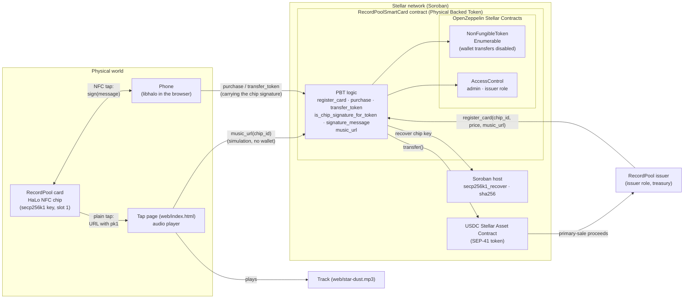
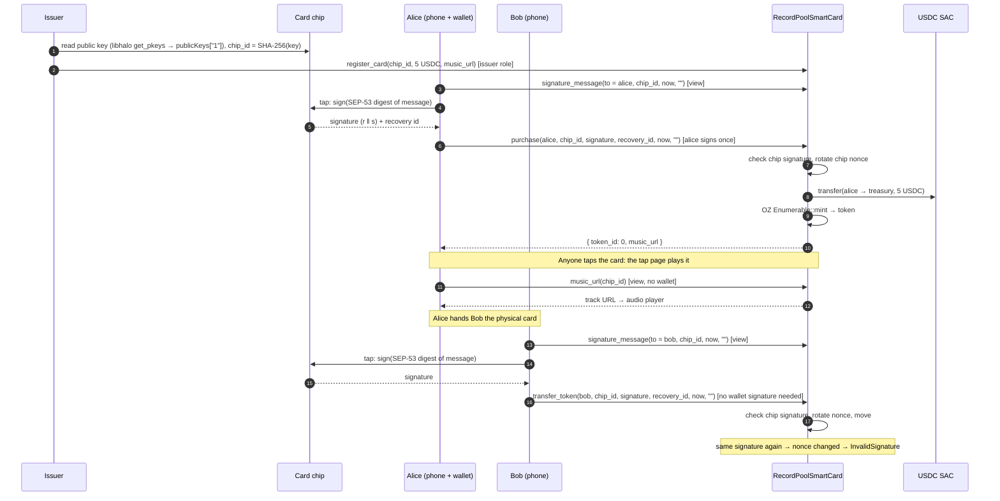

# Arx HaLo NFC Chips on Stellar Soroban — PBTs (Physical Backed Tokens) for tap-to-play music

> **Disclaimer:** This is an independent demo project. It is not affiliated with, endorsed by, or sponsored by Arx Research, the Stellar Development Foundation, OpenZeppelin or Circle. "HaLo" and "Arx" are referenced only to describe the NFC chips this demo is designed to work with.

A **RecordPool music smart card** is an NFC chip card for music: tap it on a phone and it plays.
Each card carries a [HaLo](https://github.com/arx-research/libhalo) NFC chip with its own secp256k1 key pair, which can't be read out or copied.

This Soroban contract makes each card a **Physical Backed Token**, modelled on Ethereum's [ERC-5791](https://eips.ethereum.org/EIPS/eip-5791) and rebuilt with Stellar conventions: **whoever holds the card controls the token.**
The buyer taps the card to buy it for **USDC** and gets back the URL of the track it plays. After that, anyone who taps the card hears the track. You can [try that without a card](#tap-to-play-no-card-needed-to-try-it). The token moves only when someone taps the card, and anyone can check on-chain that a card is genuine.
Stellar has no standard for physical-backed tokens yet, so this repo also includes a [draft SEP](docs/sep-draft-physical-backed-tokens.md) that brings the ERC-5791 model to Soroban, with this contract as its reference implementation. [ARCHITECTURE.md](ARCHITECTURE.md) explains the design: data structures, threat model and protocol trade-offs.

It's built on [OpenZeppelin Stellar Contracts](https://github.com/OpenZeppelin/stellar-contracts) v0.8.0.
The token standard, enumeration and role-based access control come from that audited library.
This repo adds the physical-backed-token logic: pairing chips with tokens, chip-signed minting and transfers, and USDC checkout.

| | |
|---|---|
| **Network** | Stellar testnet |
| **Contract** | [`CBVVV5ETC2PJL5V5FHWYVGHBGPMC2NC2B6FWRXKRHB4XT7YLULWRKA73`](https://stellar.expert/explorer/testnet/contract/CBVVV5ETC2PJL5V5FHWYVGHBGPMC2NC2B6FWRXKRHB4XT7YLULWRKA73) |
| **Payment token** | Circle testnet USDC — SAC [`CBIELTK6…DAMA`](https://stellar.expert/explorer/testnet/contract/CBIELTK6YBZJU5UP2WWQEUCYKLPU6AUNZ2BQ4WWFEIE3USCIHMXQDAMA) (`USDC:GBBD47IF…LFLA5`) |
| **Standard** | [Draft SEP: Physical Backed Tokens](docs/sep-draft-physical-backed-tokens.md), modelled on [ERC-5791](https://eips.ethereum.org/EIPS/eip-5791); chip signatures use the [SEP-53](https://github.com/stellar/stellar-protocol/blob/master/ecosystem/sep-0053.md) message format |
| **Hardware** | [Arx Research HaLo](https://arx-docs.vercel.app/HaLo/specifications) NFC chips (secp256k1, key slot 1), read with [libhalo](https://github.com/arx-research/libhalo) |
| **Stack** | Rust · soroban-sdk 28 · OpenZeppelin `stellar-tokens` / `stellar-access` / `stellar-macros` 0.8 · Stellar CLI 30 |

---

## What's a HaLo chip?

HaLo ("Hardware Locked") is an NFC chip made by [Arx Research](https://arx-docs.vercel.app/HaLo/specifications) for linking physical objects to blockchains. Embedded in a card, a sticker or a product, it works like a tiny hardware wallet:

- **The keys live on the chip.** It generates its own secp256k1 key pairs (the curve Bitcoin and Ethereum use). Stellar accounts use Ed25519 instead, but Soroban contracts can verify secp256k1 signatures natively, which is how this contract checks the chip. The chip offers no way to extract, replace or delete its default keys. A copied card has no key, so it can't produce valid signatures.
- **It signs when tapped.** Hold it to a phone and it signs a message, which proves that this specific physical object is present right now.
- **No app needed.** Arx's open-source [libhalo](https://github.com/arx-research/libhalo) library talks to the chip from a phone browser (Chrome on Android, Safari on iOS), from mobile apps and from desktop NFC readers.

This contract uses key slot 1, which can sign any 32-byte digest. The chip signs the digest Stellar's [SEP-53](https://github.com/stellar/stellar-protocol/blob/master/ecosystem/sep-0053.md) defines for signed messages, `SHA-256("Stellar Signed Message:\n" ‖ message)`, and its id is SHA-256 of its public key, so nothing in the design depends on Ethereum conventions.

## What's a Physical Backed Token?

[ERC-5791](https://eips.ethereum.org/EIPS/eip-5791) (draft, 2022) is the Ethereum standard for NFTs paired with chips like HaLo. Stellar has no equivalent yet, so this contract takes ERC-5791 as its model and rebuilds it with Stellar's own conventions. The rule is simple: **the chip, not a wallet, authorises every move of the token.**

- Each token is paired with one chip (`ChipSet` event, `token_id_for_chip(chip)`).
- A token moves only through `transfer_token`, with a fresh chip signature naming the recipient. Ordinary NFT transfers are disabled.
- Each signature covers the contract, the network, a per-chip nonce, the recipient and a timestamp, so it can't be replayed elsewhere, reused, or held for later.

That makes the token follow the physical card: hand someone the card, they tap it, and the token is theirs. Nobody can sell or move the token without the card.

## Why this use case

Stellar is built for payments and stablecoins. Here's how a tap-to-play music card fits:

- **Physical Backed Token**: the token stands for a specific physical card, and only the card can move it. On-chain ownership can't drift away from the physical object.
- **Stablecoin payments**: the primary sale settles in USDC through its Stellar Asset Contract (SAC), the same USDC that classic Stellar accounts, anchors and wallets already hold.
- **An ecosystem gap**: Stellar's NFT standard ([SEP-50](https://github.com/stellar/stellar-protocol/blob/master/ecosystem/sep-0050.md), draft) has no physical-backed extension. This repo proposes one.

## Architecture



### Card lifecycle



## Contract interface

| Function | Who | What it does |
|---|---|---|
| `__constructor(admin, payment_token, treasury, max_duration_window, base_uri, name, symbol)` | deployer | Runs atomically with deployment. Sets OZ metadata, the admin and `issuer` roles, and how long a chip signature stays valid. |
| `register_card(chip_id, price, music_url, operator)` | `issuer` | Adds a manufactured card to inventory, with the track it plays (an `http(s)` URL). `chip_id` is SHA-256 of the chip's key-slot-1 public key. |
| `purchase(buyer, chip_id, chip_signature, recovery_id, signature_timestamp, extras) → { token_id, music_url }` | buyer, holding the card | The chip signs a mint to `buyer`; the buyer's wallet authorises the USDC payment. Pays the treasury and mints the token in one transaction, and returns the card's track. |
| `music_url(chip_id) → url` | anyone | The track a sold card plays. This is what a plain tap looks up, as a free simulation with no wallet. Fails with `NoMappedTokenForChip` while the card is unsold. |
| `transfer_token(to, chip_id, chip_signature, recovery_id, signature_timestamp, extras) → token_id` | whoever holds the card | **PBT** (ERC-5791 `transferToken`). Moves the token to `to` on a fresh chip signature. No wallet signature needed. |
| `token_id_for_chip(chip_id) → token_id` | anyone | **PBT** (ERC-5791 `tokenIdFor`). Token paired with a chip. |
| `is_chip_signature_for_token(token_id, data, chip_signature, recovery_id) → bool` | anyone | **PBT** (ERC-5791 `isChipSignatureForToken`). True if the paired chip signed the SEP-53 digest of `data`, which must start with `pbt:verify:`. Run it as a free simulation. |
| `rotate_nonce(chip_id)` | the token's owner | Changes the chip's nonce, cancelling every chip signature not yet used (for example after lending the card). |
| `signature_message(to, chip_id, signature_timestamp, extras) → message` | anyone | The 45-byte message (`pbt:transfer:` + a 32-byte hash) the chip must sign for `purchase` / `transfer_token`. |
| `chip_nonce`, `chip_id_for_token`, `card_price`, `config` | anyone | Read-only lookups. |
| `set_treasury` | `issuer` | Changes where primary-sale proceeds go. |
| `transfer`, `transfer_from` | — | **Disabled** (`TransferRequiresChip`), as in ERC-5791. |
| **From OpenZeppelin:** `balance`, `owner_of`, `name`, `symbol`, `token_uri`, `total_supply`, `get_token_id`, `get_owner_token_id`, `grant_role`, `revoke_role`, `has_role`, `transfer_admin_role`, … | | |

### What the chip signs

```
message = "pbt:transfer:" ‖ SHA-256(
    contract
  ‖ network_id
  ‖ chip_id
  ‖ chip_nonce
  ‖ to
  ‖ signature_timestamp    (u64, big-endian)
  ‖ SHA-256(extras)
)

digest = SHA-256("Stellar Signed Message:\n" ‖ message)

signature = ECDSA-secp256k1(digest) → r ‖ s, recovery_id
```

`contract` and `to` are XDR-encoded Soroban addresses, and `network_id` is SHA-256 of the network passphrase. A client never has to rebuild this encoding: it calls the `signature_message` view, computes the SEP-53 digest, and passes that to HaLo's `sign` command (key slot 1) as `digest`. An authenticity check signs `"pbt:verify:" ‖ challenge` instead, so the two kinds of signature can't be swapped.

SEP-53 defines this digest for Stellar account keys, which sign it with Ed25519. A HaLo chip can't sign Ed25519, so it signs the same digest with its secp256k1 key. The contract then:

1. checks `signature_timestamp` is not in the future and not older than `max_duration_window`;
2. rebuilds the digest, recovers the public key with `secp256k1_recover`, and compares its SHA-256 with `chip_id`;
3. replaces the chip's nonce with `SHA-256(digest ‖ prng)`, so the same signature never works twice.

### What comes from OpenZeppelin vs. what's custom

| From OpenZeppelin | Custom (this repo) |
|---|---|
| NFT ownership, balances, `token_uri` (`NonFungibleToken`) | Pairing a chip with a token |
| Listing tokens by index (`NonFungibleEnumerable`) | Checking chip signatures |
| Admin and `issuer` roles (`AccessControl`) | Rotating the chip nonce |
| | USDC checkout in `purchase` |

The OpenZeppelin parts are switched on with three short `impl` blocks. Each one pulls in the library's default functions:

```rust
#[contractimpl(contracttrait)]
impl NonFungibleToken for RecordPoolSmartCard {
    type ContractType = Enumerable;

    // The only overrides: transfer and transfer_from always fail,
    // because a token moves only when its chip is tapped (transfer_token).
}

#[contractimpl(contracttrait)]
impl NonFungibleEnumerable for RecordPoolSmartCard {}

#[contractimpl(contracttrait)]
impl AccessControl for RecordPoolSmartCard {}
```

All the custom code is in [`contracts/recordpool-smart-card/src/contract.rs`](contracts/recordpool-smart-card/src/contract.rs). None of it re-implements anything the library already provides.

## Ethereum vs. Soroban

The ERC-721 / ERC-5791 patterns, and how this project does the same thing on Stellar. A longer version with code side by side is in [docs/ethereum-vs-soroban.md](docs/ethereum-vs-soroban.md).

| Concern | Ethereum (ERC-721 / ERC-5791 + OZ Solidity) | Soroban (this repo) |
|---|---|---|
| Building the token | Multiple inheritance: `is ERC721, ERC721Enumerable, AccessControl`, plus overrides to resolve the diamond | Pick a contract type: `type ContractType = Enumerable`. Extensions compose as types, and invalid combinations don't compile. |
| Who is calling? | Implicit `msg.sender` | Explicit `address.require_auth()`. `transfer_token` uses no wallet auth at all: the chip signature is checked by the contract. |
| Paying with USDC | `approve` tx, then the contract calls `transferFrom`: two transactions plus a standing allowance | The buyer signs **one** authorization tree that covers `purchase` and the nested `USDC.transfer`. No allowance is left behind. |
| Which USDC | An ERC-20 deployment on each chain | The **same** Circle-issued Stellar asset that wallets and anchors hold, exposed to contracts through its SAC |
| Chip identity | 20-byte address: last 20 bytes of keccak256 of the public key | 32 bytes: SHA-256 of the public key |
| Chip signature format | EIP-191 `personal_sign` (keccak256, `"\x19Ethereum Signed Message:\n"`) | SEP-53 digest (SHA-256, `"Stellar Signed Message:\n"`), signed with the chip's secp256k1 key |
| Chip signature check | `ecrecover(digest, v, r, s)` → address, zero on failure | `secp256k1_recover(digest, r‖s, recovery_id)` → public key; failure is a host error |
| Signature freshness | ERC-5791 reference: `block.timestamp` window, nonce mixed with `blockhash` | Ledger timestamp window, nonce mixed with the Soroban PRNG (there's no blockhash) |
| Cross-chain replay | `block.chainid` in the signed message | `network_id` (hash of the network passphrase) in the signed message |
| Storage cost | Pay once, stored forever | State has a TTL and rent (instance / persistent / temporary tiers). The contract extends card entries on access and its instance on every state change. |
| Initialization | Constructor, or `initialize()` behind a proxy (front-running risk) | `__constructor` runs atomically with deploy |
| Testing | Hardhat / Foundry against an EVM | Plain `cargo test` with an in-process `Env`, a real SAC, mocked or asserted auth trees |

## Run it

### Prerequisites

- Rust stable ≥ 1.91 (soroban-sdk 28's minimum) with the `wasm32v1-none` target (`rust-toolchain.toml` selects the stable channel and the target)
- [Stellar CLI](https://developers.stellar.org/docs/tools/cli) ≥ 30

### Test

```bash
# 23 contract tests (OZ + USDC SAC + simulated HaLo chip) + 3 halo-tool tests
cargo test
cargo clippy --all-targets -- -D warnings
stellar contract build --package recordpool-smart-card
```

### Deploy and run the full lifecycle on testnet

```bash
./scripts/deploy-testnet.sh
./scripts/demo.sh
```

`deploy-testnet.sh` creates and funds the `rp-admin` account, builds and deploys the contract, and writes the result to `deployments/testnet.json`.

`demo.sh` sets up Alice and Bob with testnet USDC, then runs a card through its lifecycle:

1. A simulated chip is created, and its `chip_id` is computed from its public key.
2. The issuer registers the card for sale at 5 USDC, with the track it plays.
3. Alice taps the card and buys it in one transaction.
4. A tap looks up the track, with no wallet.
5. The chip proves the card is genuine.
6. A wallet transfer is rejected: the card has to move with the chip.
7. Alice hands Bob the card, and Bob taps it to take the token. Replaying that tap is rejected.

### HaLo chips

The contract uses HaLo **key slot 1**, which can sign raw 32-byte digests through libhalo's `sign` command. SHA-256 of its public key (`publicKeys["1"]` from `get_pkeys`) is the card's `chip_id`. With a real card, the browser side looks like this (Web NFC on Android, the OS NFC prompt on iOS):

```js
import { execHaloCmdWeb } from "@arx-research/libhalo/api/web";

// 1. Read the chip's public keys.
//    chip_id = sha256(publicKeys["1"]), the id passed to register_card.
const { publicKeys } = await execHaloCmdWeb({ name: "get_pkeys" });

// 2. Ask the contract for the message to sign (a free view call).
const message = await contract.signature_message({
  to,
  chip_id,
  signature_timestamp,
  extras,
});

// 3. Turn it into a SEP-53 digest.
const digest = sha256(concat(utf8("Stellar Signed Message:\n"), message));

// 4. Have the chip sign the digest with key slot 1.
const { signature } = await execHaloCmdWeb({ name: "sign", keyNo: 1, digest });

// 5. Convert the signature into the contract's arguments.
const { r, s, v } = signature.raw;
const chip_signature = r + s;  // 64 bytes as hex: r followed by s
const recovery_id = v - 27;    // libhalo's v is 27 or 28
```

[`tools/halo-tool`](tools/halo-tool/src/main.rs) does the same conversions from the command line and simulates a chip for the tests and the demo. It doesn't use libhalo; its formats are taken from libhalo's documentation and source: the [command set](https://github.com/arx-research/libhalo/blob/master/docs/halo-command-set.md) (`sign`, `get_pkeys`), [key slots](https://github.com/arx-research/libhalo/blob/master/docs/key-slots.md), the [web](https://github.com/arx-research/libhalo/blob/master/docs/api-web.md) and [utils](https://github.com/arx-research/libhalo/blob/master/docs/api-utils.md) APIs (`signature.raw`), and [`commands.ts`](https://github.com/arx-research/libhalo/blob/master/core/src.ts/halo/commands.ts). The tap-URL parameters `pk1` and `static` are from Arx's [HaLo spec](https://arx-docs.vercel.app/HaLo/params).

```bash
# chip_id from get_pkeys publicKeys["1"]
cargo run -p halo-tool -- chip-id <pubkey>

# SEP-53 digest to pass to sign { keyNo: 1, digest }
cargo run -p halo-tool -- digest <message>

# signature.raw → "<chip_signature> <recovery_id>"
cargo run -p halo-tool -- from-halo <r> <s> <v>

# simulated chip (used by demo.sh)
cargo run -p halo-tool -- sim-keygen card.key

# simulated tap → "<chip_signature> <recovery_id>"
cargo run -p halo-tool -- sim-sign card.key <message>

# simulated chip's public key, as pk1 in a tap URL
cargo run -p halo-tool -- sim-pubkey card.key
```

### Tap to play (no card needed to try it)

You can hear the demo card without a HaLo chip. Serve the `web` folder on port 8000 and open the page for the card sold in the testnet run below:

```bash
python3 -m http.server -d web 8000
```

- As a tap would open it, with the card's public key: <http://localhost:8000/?pk1=04043aceae969469a336c872108a2aeb7a6a790a70bf044a20a579be7d3ba0cb0743006d866a2575c71bab5b8fde87a2adbde4c2a05f405a130af230d592f13ba2>
- With the `chip_id` directly: <http://localhost:8000/?chip=e39a351a4943d18a82a1ea831ed0260086af6a60c65e7dd524db068317f0b528>

With a real card, [`web/index.html`](web/index.html) is the page a plain tap opens: program the chip's URL to point at it (wherever it's hosted), and HaLo appends the chip's public key as `pk1` (or in a `static` blob). The page computes `chip_id = SHA-256(public key)`, calls `music_url` as a read-only simulation, and plays the track in an `<audio>` player. It needs no wallet and sends no transaction. `demo.sh` prints this link for the card it creates (shown here split across lines):

```text
http://localhost:8000/
    ?contract=<contract id>
    &pk1=<the card's public key, from halo-tool sim-pubkey>
```

### Testnet run (2026-11-19)

| Step | Transaction |
|---|---|
| Deploy (constructor, `max_duration_window` = 600 s) | [`5fdadd84…`](https://stellar.expert/explorer/testnet/tx/5fdadd84ef3d33dc885125d99620d4696152ca6dcc187ce72b88baa79f26c1a4) |
| `register_card` — chip `e39a351a…`, 5 USDC, track `http://localhost:8000/star-dust.mp3` | [`23854340…`](https://stellar.expert/explorer/testnet/tx/238543409383c599bfbb10a603a37b739bae8e886871dbca3f60d532df36b430) |
| `purchase` — chip-signed mint + USDC payment, one tx (`ChipSet` event); returns `token_id` 0 and the track URL | [`fa101ccd…`](https://stellar.expert/explorer/testnet/tx/fa101ccd8a0e179ca712a970c3647c46bbf9ac675e556f7fbd76a3948691fee7) |
| `music_url` — what a tap looks up: the track URL, no wallet | simulation (no tx) |
| `is_chip_signature_for_token` — genuine chip `true`, other chip `false` | simulation (no tx) |
| `transfer` by Alice's wallet — rejected (`TransferRequiresChip`) | simulation (no tx) |
| `transfer_token` — Bob taps the card and takes the token | [`e1cfa8a4…`](https://stellar.expert/explorer/testnet/tx/e1cfa8a4beb9bb0cc43b92a5308a3dbc6dbac2742acd4b76b2d1c4008a129dad) |
| Same chip signature replayed — rejected (nonce changed) | simulation (no tx) |

## Design notes and limitations

This is a demonstration project. It has **not been audited**. OpenZeppelin publishes audit reports for the library it builds on.

[ARCHITECTURE.md](ARCHITECTURE.md) explains the design decisions, the threat model and the full list of trade-offs. The main limitations:

- **No resale royalties.** A tap transfer carries no price; an escrow could add one.
- **Buying needs the card in hand.** `purchase` requires the chip's signature.
- **Trust in the chip starts with the issuer**, whose role decides which chip ids are real cards.
- **The music URL is public**, and so is the track file.
- **Not tested on a physical card.** The chip is simulated, following libhalo's documented `sign` command.

Running the demo:

- **Classic Stellar accounts need a USDC trustline** to send or receive USDC. The scripts set this up; a production checkout would handle it in the wallet flow, or use a smart-wallet `C…` address, which doesn't need one.
- **Metadata is served locally.** `token_uri` is `base_uri + token_id`, and the demo deploys with `http://localhost:8000/meta/`, so [`web/meta/0`](web/meta/0) answers `token_uri(0)`. Only token 0 has a file, which matches one demo run per deployment.

## Repo layout

| Path | What it is |
|---|---|
| [`contracts/recordpool-smart-card/`](contracts/recordpool-smart-card/) | Soroban contract (lib, storage, events, errors, tests) |
| [`tools/halo-tool/`](tools/halo-tool/) | chip ids, SEP-53 digests, simulated HaLo chip |
| [`web/index.html`](web/index.html) | tap-to-play page: chip key from the tap URL → `music_url` → audio player |
| [`web/star-dust.mp3`](web/star-dust.mp3) | the demo card's track |
| [`web/meta/0`](web/meta/0) | token 0's metadata (`token_uri`), served locally |
| [`scripts/`](scripts/) | `deploy-testnet.sh`, `demo.sh`, `common.sh` |
| [`deployments/testnet.json`](deployments/testnet.json) | live deployment record |
| [`ARCHITECTURE.md`](ARCHITECTURE.md) | design rationale: data structures, threat model, trade-offs |
| [`docs/sep-draft-physical-backed-tokens.md`](docs/sep-draft-physical-backed-tokens.md) | draft SEP: physical backed tokens on Soroban |
| [`docs/ethereum-vs-soroban.md`](docs/ethereum-vs-soroban.md) | Ethereum → Soroban comparison |
| [`docs/engagement-write-up.md`](docs/engagement-write-up.md) | engagement write-up: discovery → design → derisking → product feedback |

## License

MIT
