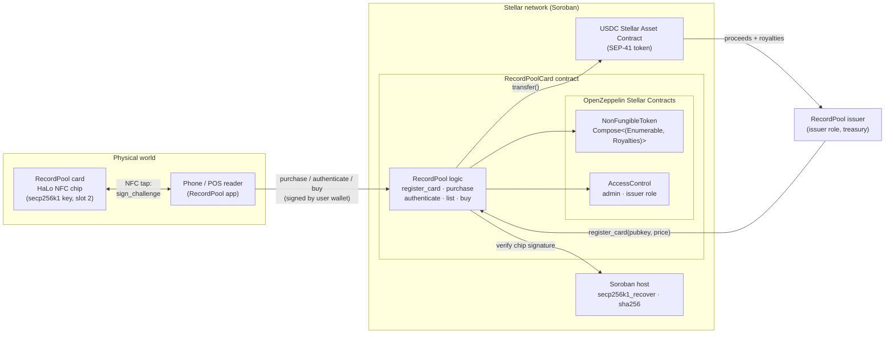
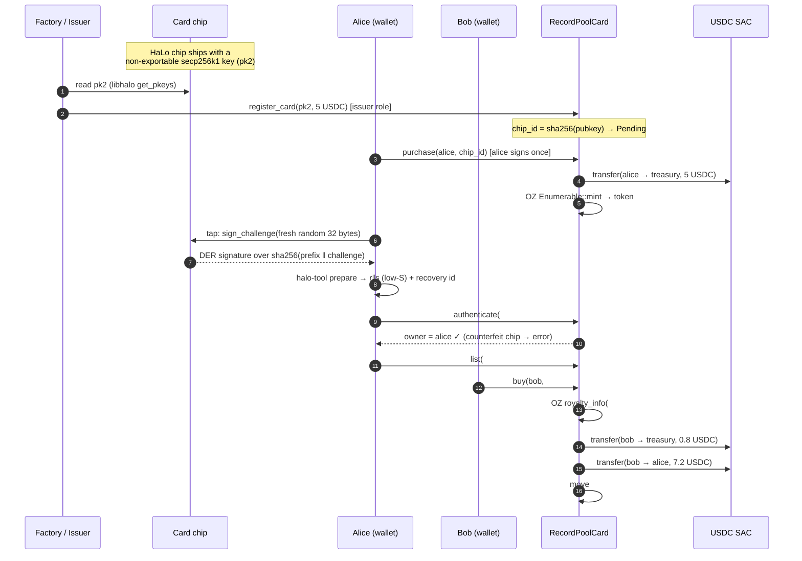

# HaLo NFC Chips on Stellar Soroban — RWA-backed NFTs for tap-to-play music cards

> **Disclaimer:** This is an independent demo project. It is not affiliated with, endorsed by, or sponsored by Arx Research, the Stellar Development Foundation, OpenZeppelin or Circle. "HaLo" and "Arx" are referenced only to describe the NFC chips this demo is designed to work with.

A **RecordPool card** is an NFC chip card for music: tap it on a phone and it plays.
Each card carries a [HaLo](https://github.com/arx-research/libhalo) NFC chip with its own secp256k1 key pair, which can't be read out or copied.
This Soroban contract gives each card exactly one on-chain token, sells it for **USDC**,
lets anyone holding the card **prove on-chain that it's genuine**, and **enforces a royalty** when it's resold.

It's built on [OpenZeppelin Stellar Contracts](https://github.com/OpenZeppelin/stellar-contracts) v0.8.0.
The token standard, enumeration, royalty bookkeeping and role-based access control come from that audited library.
This repo only adds the RecordPool-specific logic: binding chips to tokens, USDC checkout, chip authentication and resale settlement.

| | |
|---|---|
| **Network** | Stellar testnet |
| **Contract** | [`CDHRGMDZHKYNUUC3BDOLYPNHVLHCWKAA5L5C4YCHTNODQ6A3QXEJZYKP`](https://stellar.expert/explorer/testnet/contract/CDHRGMDZHKYNUUC3BDOLYPNHVLHCWKAA5L5C4YCHTNODQ6A3QXEJZYKP) |
| **Payment token** | Circle testnet USDC — SAC [`CBIELTK6…DAMA`](https://stellar.expert/explorer/testnet/contract/CBIELTK6YBZJU5UP2WWQEUCYKLPU6AUNZ2BQ4WWFEIE3USCIHMXQDAMA) (`USDC:GBBD47IF…LFLA5`) |
| **Hardware** | [Arx Research HaLo](https://arx-docs.vercel.app/HaLo/specifications) NFC chips (secp256k1), read with [libhalo](https://github.com/arx-research/libhalo) |
| **Stack** | Rust · soroban-sdk 28 · OpenZeppelin `stellar-tokens` / `stellar-access` / `stellar-macros` 0.8 · Stellar CLI 30 |

---

## What's a HaLo chip?

HaLo ("Hardware Locked") is an NFC chip made by [Arx Research](https://arx-docs.vercel.app/HaLo/specifications) for linking physical objects to blockchains. Embedded in a card, a sticker or a product, it works like a tiny hardware wallet:

- **The keys live on the chip.** It generates its own secp256k1 key pairs (the curve Bitcoin and Ethereum use). The chip offers no way to extract, replace or delete its default keys. A copied card has no key, so it can't produce valid signatures.
- **It signs when tapped.** Hold it to a phone and it can sign a message, which proves that this specific physical object is present right now.
- **No app needed.** Arx's open-source [libhalo](https://github.com/arx-research/libhalo) library talks to the chip from a phone browser (Chrome on Android, Safari on iOS), from mobile apps and from desktop NFC readers.

In this demo, each RecordPool card's HaLo key is recorded on-chain when the card is registered, and the Soroban contract checks the chip's signatures with a native host function. See [HaLo chips](#halo-chips) below for the exact signing format.

## Why this use case

Stellar is built for payments, stablecoins and real-world assets. A tap-to-play music card touches all three:

- **RWA**: the token stands for a specific physical card. The chip's public key is stored on-chain, so the token and the card are cryptographically linked. The NFC tap that plays the music can also have the chip sign a challenge, which proves the card is genuine.
- **Stablecoin payments**: both the primary sale and resales settle in USDC through its Stellar Asset Contract (SAC). It's the same USDC that classic Stellar accounts, anchors and wallets already hold.
- **Programmable commerce**: the royalty is paid out inside the resale transaction. It isn't left to a marketplace to honour. A royalty can be set per card, so resales of an artist's card can pay that artist.

## Architecture



### Card lifecycle



## Contract interface

| Function | Who | What it does |
|---|---|---|
| `__constructor(admin, payment_token, treasury, royalty_bps, base_uri, name, symbol)` | deployer | Runs atomically with deployment. Sets OZ metadata, the default royalty, the admin and the `issuer` role. |
| `register_card(chip_pubkey, price, operator)` | `issuer` | Adds a manufactured card to inventory and returns its `chip_id`. |
| `purchase(buyer, chip_id) → token_id` | buyer | Pays `price` in USDC to the treasury and mints the token, in one atomic transaction. |
| `authenticate(token_id, challenge, signature, recovery_id) → owner` | anyone | Verifies the HaLo chip's `sign_challenge` signature on-chain by recovering the signer key. Run it as a free simulation. |
| `list(seller, token_id, price)` / `cancel_listing` | owner | Creates or cancels a resale listing. |
| `buy(buyer, token_id)` | buyer | Pays the royalty and the seller from one signature, then moves the token. |
| `card_price`, `token_for_chip`, `chip_pubkey`, `get_listing`, `config` | anyone | Read-only lookups. |
| `set_treasury` | `issuer` | Changes where primary-sale proceeds go. |
| **From OpenZeppelin:** `balance`, `owner_of`, `transfer`, `transfer_from`, `approve`, `approve_for_all`, `name`, `symbol`, `token_uri`, `total_supply`, `get_token_id`, `get_owner_token_id`, `royalty_info`, `set_default_royalty`, `set_token_royalty`, `grant_role`, `revoke_role`, `has_role`, `transfer_admin_role`, … | | |

### What comes from OpenZeppelin vs. what's custom

```rust
// The token standard is assembled from OZ extensions, not hand-written:
#[contractimpl(contracttrait)]
impl NonFungibleToken for RecordPoolCard {
    type ContractType = Compose<(Enumerable, Royalties)>;
    // transfer/transfer_from wrapped only to invalidate stale resale listings
}
#[contractimpl(contracttrait)] impl NonFungibleEnumerable for RecordPoolCard {}
#[contractimpl(contracttrait)] impl NonFungibleRoyalties  for RecordPoolCard { /* #[only_role(operator, "issuer")] */ }
#[contractimpl(contracttrait)] impl AccessControl         for RecordPoolCard {}
```

All the custom code is in [`contracts/recordpool-card/src/contract.rs`](contracts/recordpool-card/src/contract.rs). It's about 200 lines of business logic, and none of it re-implements anything the library already provides.

## Ethereum vs. Soroban

The ERC-721 patterns, and how this project does the same thing on Stellar. A longer, partner-facing version with code side by side is in [docs/ethereum-vs-soroban.md](docs/ethereum-vs-soroban.md).

| Concern | Ethereum (ERC-721 + OZ Solidity) | Soroban (this repo) |
|---|---|---|
| Building the token | Multiple inheritance: `is ERC721, ERC721Enumerable, ERC2981, AccessControl`, plus `_update` / `supportsInterface` overrides to resolve the diamond | Type-level composition: `type ContractType = Compose<(Enumerable, Royalties)>`. Invalid combinations don't compile. |
| Who is calling? | Implicit `msg.sender` | Explicit `address.require_auth()`. Accounts and contracts are both `Address`. |
| Paying with USDC | `approve` tx, then the contract calls `transferFrom`: two transactions plus a standing allowance | The buyer signs **one** authorization tree that covers `purchase` and the nested `USDC.transfer`. No allowance is left behind. |
| Which USDC | An ERC-20 deployment on each chain | The **same** Circle-issued Stellar asset that wallets and anchors hold, exposed to contracts through its SAC |
| Royalties | ERC-2981 is advisory; marketplaces may ignore it | `royalty_info` from OZ, paid out inside `buy()` in the same transaction |
| Approvals | Live until revoked | Kept in temporary storage with a `live_until_ledger` expiry |
| Storage cost | Pay once, stored forever | State has a TTL and rent (instance / persistent / temporary tiers). The contract bumps TTLs on access. |
| Initialization | Constructor, or `initialize()` behind a proxy (front-running risk) | `__constructor` runs atomically with deploy |
| Physical-chip signatures (HaLo, secp256k1) | Native too: `ecrecover` | `secp256k1_recover` host function. Soroban also has `secp256r1_verify` for P-256 chips and passkeys. |
| `safeTransferFrom` receiver hook | `onERC721Received` | No receiver hook (OZ documents this) |
| Testing | Hardhat / Foundry against an EVM | Plain `cargo test` with an in-process `Env`, a real SAC, mocked or asserted auth trees |

## Run it

### Prerequisites

- Rust stable ≥ 1.91 with the `wasm32v1-none` target (pinned in `rust-toolchain.toml`)
- [Stellar CLI](https://developers.stellar.org/docs/tools/cli) ≥ 30

### Test

```bash
cargo test                       # 23 contract tests (OZ + USDC SAC + simulated HaLo chip) + 3 halo-tool tests
cargo clippy --all-targets -- -D warnings
stellar contract build --package recordpool-card
```

### Deploy and run the full lifecycle on testnet

```bash
./scripts/deploy-testnet.sh      # creates/funds rp-admin, deploys, writes deployments/testnet.json
./scripts/demo.sh                # alice + bob: swap XLM→USDC on the testnet DEX, buy, tap, resell
```

### HaLo chips

Each card carries a [HaLo](https://github.com/arx-research/libhalo) NFC chip from Arx Research. HaLo keys are secp256k1 and can't be exported. Key slot 2 (`pk2`) is the card's identity. That slot can't sign arbitrary digests, only domain-separated messages such as `sign_challenge`:

```
signature = ECDSA-secp256k1( SHA-256( "\x19External chall pk2:\n" ‖ challenge[32] ) )   → DER
```

The contract recomputes the same digest and calls Soroban's `secp256k1_recover`. Because of the prefix, a signature the chip makes for any other purpose can't be passed off as a card authentication (the test suite checks this).

HaLo returns DER, but Soroban needs 64-byte r‖s with a low S value plus a recovery id. [`tools/halo-tool`](tools/halo-tool/src/main.rs) does that conversion and can also simulate a chip:

```bash
cargo run -p halo-tool -- challenge                                # fresh 32-byte challenge
cargo run -p halo-tool -- prepare <pk2> <challenge> <der-sig>      # → "<signature> <recovery_id>"
cargo run -p halo-tool -- sim-keygen card.key                      # simulated chip (used by demo.sh)
cargo run -p halo-tool -- sim-sign-challenge card.key <challenge>
```

With a real card, the browser side uses libhalo (Web NFC on Android, the OS NFC prompt on iOS):

```js
import { execHaloCmdWeb } from "@arx-research/libhalo/api/web";

const { publicKeys } = await execHaloCmdWeb({ name: "get_pkeys" });                      // pk2 → register_card
const { signature } = await execHaloCmdWeb({ name: "sign_challenge", challenge: hex32 }); // DER → halo-tool prepare
```

### Testnet run (2026-11-08)

| Step | Transaction |
|---|---|
| Deploy (constructor) | [`88536dd8…`](https://stellar.expert/explorer/testnet/tx/88536dd8f2a7a831ad7aa2ddc0b8921fd6df980602fa87a5053a1a6462bdd089) |
| `register_card` — 5 USDC | [`79b2d0b2…`](https://stellar.expert/explorer/testnet/tx/79b2d0b2adfb5923bc5e89113d65e39014e399c8e6d3afe1845b23a329552b01) |
| `purchase` — USDC transfer + mint, one tx | [`fc73ae9c…`](https://stellar.expert/explorer/testnet/tx/fc73ae9c9408a641db3328d31c9cfceaf47a7b19715b83f46e259acafd22a4b1) |
| `authenticate` — genuine HaLo signature ✓, counterfeit ✗ | simulation (no tx) |
| `list` — 8 USDC | [`14c2e186…`](https://stellar.expert/explorer/testnet/tx/14c2e186bd7c310c281593f4035e8a924a63d30bd0a862405751bd2b6e4701e1) |
| `buy` — 0.80 USDC royalty + 7.20 USDC to seller + transfer | [`d1474e4b…`](https://stellar.expert/explorer/testnet/tx/d1474e4b3cc583dcbcfb59081a128830831ee19c1b46b7aa4b6b4893289687d6) |

## Design notes and limitations

This is a demonstration project. It has **not been audited**. OpenZeppelin publishes audit reports for the library it builds on.

- **Royalties are enforced only on sales that go through `buy()`.** A plain OZ `transfer` between two wallets can still settle payment off-chain, the same gap ERC-2981 has. A production version could restrict `transfer` (for example, only allowed when the price is zero or to allow-listed marketplaces) at the cost of composability.
- **Freshness of `authenticate` is up to the verifier.** It's a stateless, read-only check, so the app has to generate a random challenge for every tap. A stateful version could issue on-chain nonces, or require a chip signature over the buyer's address inside `purchase` to prove possession at checkout.
- **Trust in the chip key starts with the issuer.** `register_card` is gated by the `issuer` role, so whoever holds that role vouches for which keys are real cards. HaLo chips also return a manufacturer attestation for each key (`get_key_info` → `attestSig`), which a production version could check at registration.
- **The tap-to-play URL isn't verified on-chain.** A HaLo tap also opens a dynamic URL carrying a counter-based signature (`rnd` / `rndsig`). This demo uses an explicit `sign_challenge` instead, because its format is fully documented in libhalo.
- **Classic Stellar accounts need a USDC trustline** to send or receive USDC. The scripts set this up; a production checkout would handle it in the wallet flow (or use a smart-wallet `C…` address, which doesn't need one).
- **Token IDs are `u32`** (the OZ default). Metadata comes from `base_uri + token_id`.

## Repo layout

```
contracts/recordpool-card/   Soroban contract (lib, storage, events, errors, 23 tests)
tools/halo-tool/             HaLo signature converter + chip simulator
scripts/                     deploy-testnet.sh, demo.sh, common.sh
deployments/testnet.json     live deployment record
docs/ethereum-vs-soroban.md  partner-facing comparison
```

## License

MIT
