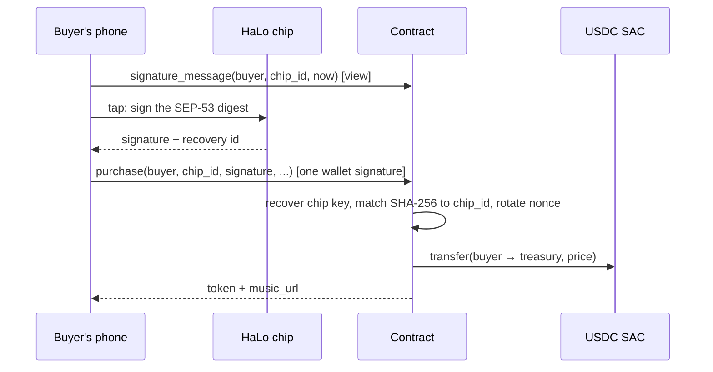

# RecordPool on Stellar: Engagement Write-up

*2026-11-18 · David Geddes*

*A case study of how this demo was built, written for Stellar's partner and solutions engineering team. For the code itself, start with the [README](../README.md).*

## Summary

I ran a full partner engagement on myself: RecordPool, my phygital music platform on Ethereum, as the partner, and Stellar as the target. In four stages I went from discovery to a working testnet integration, and fed one standards gap back as a draft SEP.

1. **Discovery:** what RecordPool needs, and what changes moving from EVM to Soroban.
2. **Solution design:** a Physical Backed Token (PBT) contract, modelled on [ERC-5791](https://eips.ethereum.org/EIPS/eip-5791), with a threat model in SDF's STRIDE format.
3. **Derisking:** a prototype with 38 tests, a simulated chip, an adversarial code review and a live testnet deploy.
4. **Feedback to Product:** a draft SEP for chip-backed tokens, plus the tooling friction I hit.

The result is a public repo a partner's engineers could fork, and a template for how I'd run engagements at the Stellar Development Foundation (SDF).

## Discovery

The partner's core need: a physical music card whose token moves only when the card itself is tapped and sold for USDC. Today RecordPool verifies NTAG 424 chips on a backend, with Ethereum Attestation Service (EAS) attestations and 0xSplits payouts on Ethereum.

NTAG 424 proves a tap with a shared AES key, so only a backend holding that key can check it. A [HaLo](https://github.com/arx-research/libhalo) chip signs with a secp256k1 key that never leaves the chip, and a contract can check that signature itself. That is why the design moves to HaLo and takes the backend out of the trust path.

Requirements I took into design:

- The chip's private key never leaves the card, and verification happens on-chain, not on a server.
- A tap must authenticate, buy and transfer; wallet transfers are disabled.
- Payment in USDC, with fees small enough for a consumer purchase.
- Tap to play without a wallet, a fee or a transaction.

The EVM-to-Stellar assessment ([ethereum-vs-soroban.md](ethereum-vs-soroban.md)) found the biggest shifts in auth, storage and token payments:

| Area | Ethereum | Stellar | Effect on the design |
| --- | --- | --- | --- |
| Payment auth | approve, then transferFrom | One signed auth tree covers the call and the USDC transfer | One signature, no approve step |
| Storage | Permanent | Each entry has a TTL (time to live); archived entries can be restored | Extend TTL on access |
| Stablecoin | ERC-20 contract | USDC through its Stellar Asset Contract (SAC) | Native USDC, no wrapper |
| Signed messages | EIP-191 | [SEP-53](https://github.com/stellar/stellar-protocol/blob/master/ecosystem/sep-0053.md) | Rebuilt the message encoding |

## Solution design

The design reuses OpenZeppelin Stellar Contracts, an audited library, for the NFT and adds only the chip logic: pairing, signature checks, nonce rotation and USDC checkout. The full review is in [ARCHITECTURE.md](../ARCHITECTURE.md).

One tap does the whole purchase:

Later owners move the token with the same tap through `transfer_token`, with no wallet signature. The full card lifecycle is in the [README](../README.md#card-lifecycle).

| Decision | Why | Trade-off accepted |
| --- | --- | --- |
| Model on ERC-5791, rebuild every encoding the Stellar way | Keeps a known interface; fits [SEP-50](https://github.com/stellar/stellar-protocol/blob/master/ecosystem/sep-0050.md) and SEP-53 | Ethereum PBT signatures won't verify here |
| Recover the chip's key on-chain and match its SHA-256 to `chip_id` | No backend in the trust path | One recovery per tap |
| Sign the contract, network, nonce, recipient and timestamp | Stops replay and front-running | A slow transaction can miss the 600 s window |
| Tag every signed message by purpose (`pbt:transfer:`, `pbt:verify:`) | A "verify this card" tap can never authorise a transfer | Signatures differ from ERC-5791's format |
| Let the owner rotate the chip's nonce (`rotate_nonce`) | Cancels transfers pre-signed while the card was lent out | Needs the owner's wallet: one extra transaction |
| Disable wallet transfers; move tokens only by tap | Ownership follows the object | No plain marketplace transfers |
| Keep the music URL in public storage, gated in the page | Tap to play needs no wallet or fee | Anyone can read the URL |
| Leave royalties out, as ERC-5791 does | A tap carries no on-chain price to take a cut from | No resale royalties; an escrow is sketched in ARCHITECTURE.md |

The [threat model](stride-threat-model.md) uses SDF's [STRIDE template](https://developers.stellar.org/docs/build/security-docs/threat-modeling/STRIDE-template). It looks at two trust boundaries: the NFC link, which any app the user taps into can drive, and the pending transaction, which anyone can see. The main finding in each category:

| STRIDE category | Main finding | How it's handled |
| --- | --- | --- |
| Spoofing | A counterfeit card copies the chip's public key | The contract recovers the signer's key and matches it to `chip_id` |
| Tampering | A pending signature is replayed or redirected | The nonce, contract, network and recipient are all signed |
| Repudiation | A buyer denies a purchase | Wallet and chip signatures, plus contract events, on the ledger |
| Information disclosure | The ledger links a card to every account that has held it | Accepted: ownership is public by design |
| Denial of service | Storage entries expire and calls fail | TTLs extended on access and on every state change |
| Elevation of privilege | A "verify this card" tap is submitted as a transfer | Every signed message is tagged by purpose |

Every issue has a fix or a stated acceptance. The main accepted risks: a malicious app that gets a tap can still have the chip sign a transfer, anyone can read the music URL, and a lost card means a lost token.

## Derisking

I proved the riskiest parts before any hardware: the contract is live on testnet, and most of the threat model's fixes have a test.

- **Simulated chip:** `halo-tool` signs the exact SEP-53 digest with k256, the same way the HaLo chip does, and converts real libhalo output (`v − 27`).
- **Tests:** 35 contract tests and 3 tool tests. They cover counterfeit chips, buyer and recipient binding, single use, the window edges, contract and network binding, a bad recovery id, disabled wallet transfers, the music URL unlocking at sale, events, storage TTLs, and both signature-hardening fixes below.
- **Code review:** an adversarial review with three independent passes (diff only, diff plus repo, and code against ARCHITECTURE.md and the SEP), then a Soroban security checklist. It found two protocol issues: an authenticity-check signature could be submitted as a transfer, and a borrowed card could pre-sign a future-dated transfer. Both are fixed with purpose tags and `rotate_nonce`, tested, and written into the draft SEP.
- **Testnet:** redeployed on 2026-11-19 after the review, paid in Circle testnet USDC. The WASM records its source repo and commit, readable with `stellar contract info meta`. `deploy-testnet.sh` and `demo.sh` reproduce it end to end.
- **Front end:** I ran the tap page's code in Node against the live contract, including compressed keys.
- **CI:** runs fmt, clippy and the tests, and builds the WASM with source metadata, on every push.
- **Not done yet:** a security audit of this contract, and a run on a physical HaLo card. The simulated chip follows libhalo's documented `sign` output.

## Feedback to Product

The biggest gap was a missing standard, so I drafted one: [a SEP for Physical Backed Tokens](sep-draft-physical-backed-tokens.md), as a SEP-50 extension.

| Gap | What I did | What I'd ask for |
| --- | --- | --- |
| SEP-50 has no extension for chip-backed tokens | Drafted the interface, the message format over SEP-53, freshness rules, purpose tags, optional owner nonce rotation and security notes | Review as a SEP, so wallets and chip tooling can support any PBT contract |
| OpenZeppelin Stellar leaves contract-instance TTL to the contract | Extended the instance on every state change | A documented default or helper |
| Testnet USDC needs its Stellar Asset Contract deployed per network | The deploy script deploys it and treats "already exists" (`ExistingValue`) as success | A note in the USDC testnet docs |

## Scaling it into a program

Each stage of this engagement can become a standard deliverable, so the team runs every partner the same way and the depth matches the partner's tier.

| Program element | From this project | At scale |
| --- | --- | --- |
| Engagement model | Discovery, design, derisking, feedback | The same four stages for every partner, with an exit check for each |
| Documentation standard | Migration assessment, design review and a STRIDE threat model | Templates every solutions engineer (SE) fills in, reviewed before launch |
| Partner tiering | A full prototype for one partner | High-tier partners get a prototype; others get reference repos and design reviews |
| Certification | A reference build with tests for each threat | New SEs, in-house and external, rebuild a reference integration to be certified |
| Product feedback loop | Gaps logged and a draft SEP | Gaps logged per engagement and rolled up to Product and Engineering |

## Links

- [Repository](https://github.com/sabotensf/arx-halo-soroban-demo)
- [Architecture](../ARCHITECTURE.md)
- [STRIDE threat model](stride-threat-model.md)
- [Ethereum vs Soroban assessment](ethereum-vs-soroban.md)
- [Draft SEP: Physical Backed Tokens](sep-draft-physical-backed-tokens.md)
- [Testnet contract](https://stellar.expert/explorer/testnet/contract/CATWP7NFVDA2CRHWYFUSCULX7R7HDCYPQYXE7XFHW7R3RBK7VBZN65HO)
