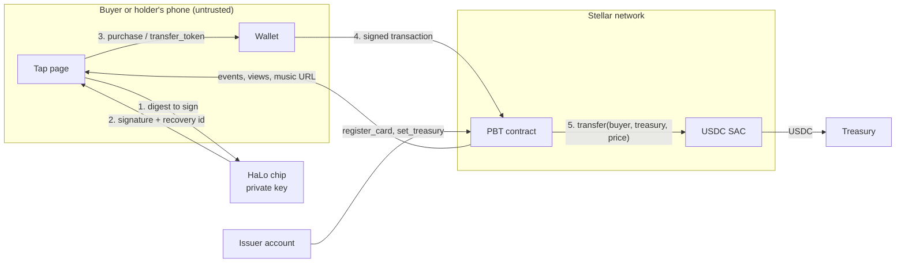

# STRIDE Threat Model: RecordPool Smart Card

*2026-11-20 · David Geddes*

*This follows SDF's [STRIDE threat model template](https://developers.stellar.org/docs/build/security-docs/threat-modeling/STRIDE-template). The design decisions and trade-offs behind it are in [ARCHITECTURE.md](../ARCHITECTURE.md).*

## What are we working on?

A Soroban contract that sells and transfers Physical Backed Tokens (PBTs), modelled on [ERC-5791](https://eips.ethereum.org/EIPS/eip-5791). Each token is paired with an Arx HaLo NFC card, which holds a secp256k1 key that never leaves the chip.

- **Register:** an account with the `issuer` role registers a card's `chip_id` (the SHA-256 of its public key), price and music URL.
- **Purchase:** the buyer taps the card. The chip signs a [SEP-53](https://github.com/stellar/stellar-protocol/blob/master/ecosystem/sep-0053.md) message naming the contract, network, chip nonce, buyer and timestamp. The buyer submits it with one wallet signature, which also authorizes the USDC payment through the Stellar Asset Contract. The contract recovers the chip's key, checks it against `chip_id`, rotates the nonce, takes payment and mints the token.
- **Transfer:** whoever holds the card taps it to move the token to a named recipient. No wallet signature is needed, and wallet transfers are disabled.
- **Verify and play:** anyone can check a card is genuine with `is_chip_signature_for_token`, and play a sold card's track from its public music URL.

### Data flow

The trust boundaries are the NFC link (1–2), which any page the user taps into can drive, and the transaction (3–4), which anyone watching the network can see before it lands.

### Actors

| Actor | Can | Cannot |
|---|---|---|
| Card holder | Move the token to anyone by tapping | Move a token without its card |
| Token owner | Cancel unused chip signatures (`rotate_nonce`) | Move the token without its card |
| Token owner without the card | Nothing to the token | Transfer it: wallet transfers fail (3010) |
| Issuer (role) | Register new chips, set the treasury | Move, burn or re-pair any minted token |
| Admin | Grant and revoke roles (two-step admin transfer) | Move any token |
| Observer of pending transactions or the ledger | See signatures and chip ids | Redirect a signature (`to` is bound) or replay it (nonce) |
| Anyone | Call views, play a sold card's track | Change state without a chip signature or a role |

### Threat table

| Threat | Issues |
| --- | --- |
| **S**poofing | **Spoof.1** - A counterfeit card copies a real chip's public key, which any reader can get, and poses as the real card. **Spoof.2** - A software key is registered as a "card", and fakes are sold as genuine. **Spoof.3** - A malicious tap page asks a genuine chip to sign a transfer to the attacker. |
| **T**ampering | **Tamper.1** - An observer copies a pending signature and changes the recipient or `extras` before it lands. **Tamper.2** - A used signature is replayed on the same contract, another deployment or another network. **Tamper.3** - The purchase is cut short, so USDC moves without a mint or a token mints without payment. **Tamper.4** - A registered music URL uses a scheme such as `javascript:` that runs in the tap page. |
| **R**epudiation | **Repudiate.1** - A buyer denies a purchase, or a past owner denies handing over the card. **Repudiate.2** - A signature checked with `is_chip_signature_for_token` is claimed as fresh when it was captured earlier. |
| **I**nformation Disclosure | **Info.1** - The music URL sits in public contract storage, so anyone can read it. **Info.2** - Chip ids, signatures and wallet addresses on the ledger link a physical card to every account that has held it. |
| **D**enial of Service | **DoS.1** - Contract or card entries reach their TTL and are archived, and calls fail. **DoS.2** - A slow transaction misses the signature window and is rejected. **DoS.3** - A lost or damaged card leaves its token stuck. **DoS.4** - Malformed signatures passed to `is_chip_signature_for_token` trap the host instead of returning `false`. |
| **E**levation of Privilege | **Elevation.1** - The token's owner moves it by wallet without the card. **Elevation.2** - A stolen issuer key is used to take sold tokens. **Elevation.3** - A "verify this card" signature is submitted as a transfer. **Elevation.4** - Someone who borrows the card pre-signs a future-dated transfer to themselves. **Elevation.5** - The admin role is handed to the wrong account. |

## What are we going to do about it?

| Threat | Remediations |
| --- | --- |
| **S**poofing | **Spoof.1.R.1** - The contract recovers the signer's key and requires its SHA-256 to equal `chip_id`; a copy without the private key fails (3006). Tested by `purchase_requires_the_chip`. **Spoof.2.R.1** - `register_card` is gated by `#[only_role(operator, "issuer")]`. Tested by `only_issuer_can_register`. **Spoof.2.R.2** - *Accepted for the demo.* Production should verify HaLo's manufacturer attestation (`attestSig`) at registration. **Spoof.3.R.1** - The SEP-53 prefix and the message binding limit what a signature can be used for: one contract, one network, one recipient, once. **Spoof.3.R.2** - *Accepted.* Key slot 1 signs any digest, so a page that gets a tap can still have the chip sign a transfer to the attacker. Users should only tap into apps they trust. |
| **T**ampering | **Tamper.1.R.1** - The recipient and `extras` are inside the signed message. Tested by `transfer_signature_names_the_recipient`, `purchase_signature_names_the_buyer` and `extras_are_signed`. **Tamper.2.R.1** - Each chip's nonce changes after every accepted signature and lives in persistent storage, so it can't expire back to zero. Tested by `chip_signature_is_single_use`. **Tamper.2.R.2** - The contract address and `network_id` are in the message. Tested by `signature_is_bound_to_this_contract` and `signature_is_bound_to_the_network`. **Tamper.3.R.1** - Payment and mint run in one atomic transaction. Tested by `underfunded_purchase_is_atomic`. **Tamper.4.R.1** - Registration accepts only `http://` and `https://` URLs (3011). Tested by `register_needs_an_http_music_url`. |
| **R**epudiation | **Repudiate.1.R.1** - Every purchase carries the buyer's wallet signature and a chip signature, and the contract emits `CardPurchased`, `ChipSet` and `NonceRotated` events, so the ledger records who did what. Tested by `state_changes_emit_events`. **Repudiate.2.R.1** - *Accepted.* The check is stateless: it proves who signed, not when. Callers must put a fresh random value after the `pbt:verify:` tag. |
| **I**nformation Disclosure | **Info.1.R.1** - *Accepted.* Tap to play needs no wallet or fee. Protecting the audio would need a server that checks a fresh chip signature before streaming. **Info.2.R.1** - *Accepted.* Ownership history is public by design, as on any public ledger. A card's holders can use fresh accounts if they want less linkage. |
| **D**enial of Service | **DoS.1.R.1** - Card entries are extended on access and the instance on every state change; archived persistent entries can be restored. Tested by `each_state_change_extends_instance_ttl` and `transfer_keeps_the_card_entries_live`. **DoS.2.R.1** - *Accepted.* The window (600 s on testnet) bounds unsubmitted signatures; a late one is retried with a new tap. Tested by `signature_timestamp_window`. **DoS.3.R.1** - *Accepted.* Possession is ownership, so there is no recovery path; adding one would let a token move without its card. **DoS.4.R.1** - The contract rejects a recovery id other than 0 or 1 (3007) before recovery. Tested by `recovery_id_must_be_0_or_1`. **DoS.4.R.2** - *Accepted.* A trap fails only the caller's own call, and is documented for integrators. |
| **E**levation of Privilege | **Elevation.1.R.1** - Wallet transfers are disabled (3010). Tested by `wallet_transfers_are_disabled`. **Elevation.2.R.1** - The issuer role can register cards and set the treasury, but can't move, burn or re-pair a minted token. A stolen key risks fake listings and future proceeds, not existing tokens. **Elevation.3.R.1** - Signed messages are tagged by purpose (`pbt:transfer:`, `pbt:verify:`), so one can't stand in for the other. Tested by `verification_signature_cant_move_the_token` and `verification_data_needs_the_verify_tag`. **Elevation.4.R.1** - The owner can call `rotate_nonce` to cancel every unused signature. Tested by `owner_can_cancel_unused_signatures` and `rotate_nonce_needs_the_owner`. **Elevation.4.R.2** - *Accepted.* The owner has to know to rotate; until then the signature works once its timestamp arrives, if the card hasn't moved. **Elevation.5.R.1** - OpenZeppelin AccessControl's two-step admin transfer: the new admin must accept. |

## Did we do a good job?

- **Has the data flow diagram been referenced since it was created?** Yes. Each issue above sits on one of its two trust boundaries, the NFC link or the pending transaction, or on the issuer's path into the contract.
- **Did the STRIDE model uncover any new design issues?** One: **Info.2**, the link between a card and every account that has held it. The earlier design notes listed what an observer can see, but not this privacy cost. **Elevation.3** and **Elevation.4** were found earlier, by the adversarial code review, and are fixed.
- **Did the treatments adequately address the issues?** Every issue has a remediation or a stated acceptance. Of the mitigations, all but Spoof.3.R.1, Elevation.2.R.1 and Elevation.5.R.1 have a contract test.
- **Have additional issues been found after the threat model?** Not yet. The contract hasn't had an external audit or a run on a physical HaLo card.
- **Thoughts for next time:** run STRIDE at design time, before the code review. Here it came after, so it mostly confirmed what the review had found.
